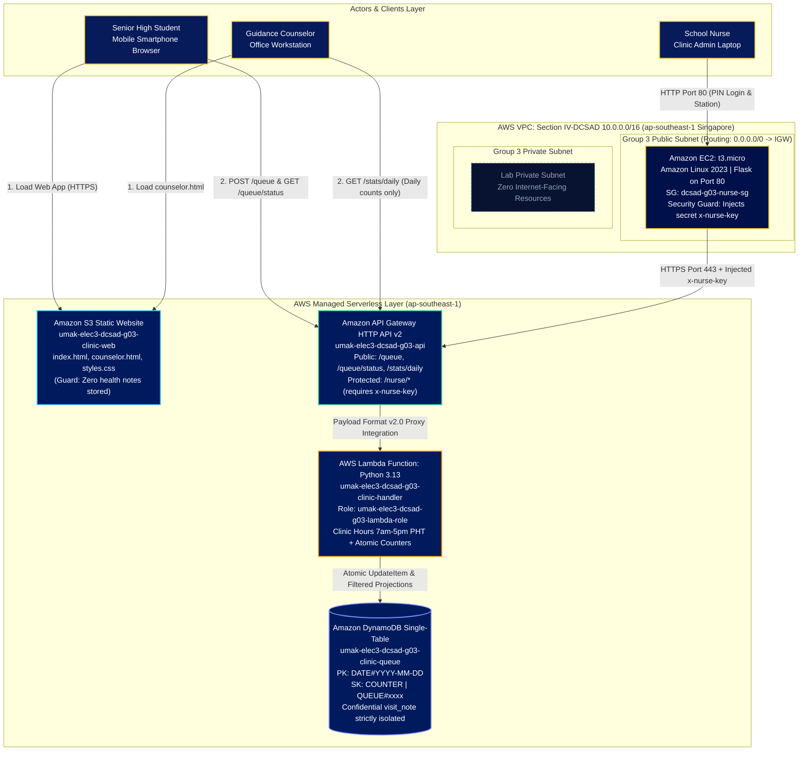

# University of Makati — ELEC3 Cloud Computing (Track B Final Exam)
## Section IV-DCSAD | Group 3 (`dcsad-g03`)
### Case 4: School Clinic Visit Queue — Architecture Diagram

This document contains both the **Mermaid.js Diagram Code** (for live markdown viewing and documentation) and instructions for the **draw.io Diagram XML** saved at `docs/architecture-diagram.drawio` for inclusion in your `DCSAD-B-03.pdf`.

---

## 1. Mermaid Architecture Diagram

---

## 2. draw.io Diagram File Location

The raw draw.io XML is saved in your repository at:
`docs/architecture-diagram.drawio`

### How to Open & Export in draw.io (diagrams.net):
1. Go to **[https://app.diagrams.net/](https://app.diagrams.net/)**.
2. Click **File** &rarr; **Open From** &rarr; **Device** and select `docs/architecture-diagram.drawio`.
   *(Or click **Arrange** &rarr; **Insert** &rarr; **Advanced** &rarr; **From Text...** and paste the raw XML).*
3. The diagram will render in full UMak Navy & Gold theme with VPC subnets, security boundaries, and data flows.
4. Click **File** &rarr; **Export as** &rarr; **PNG** (or **PDF**) at 300 DPI to paste directly into your **`DCSAD-B-03.pdf`** submission template!
